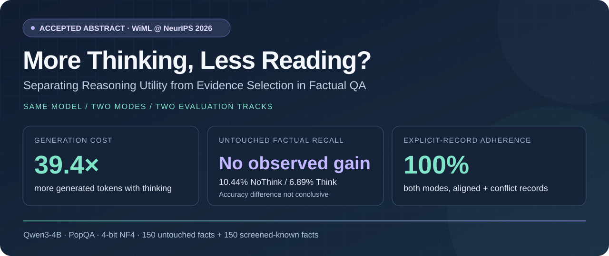
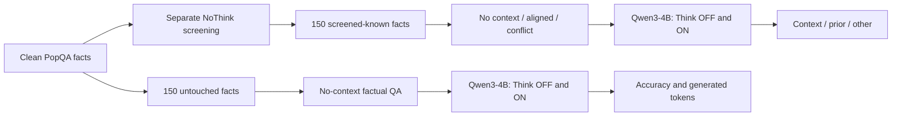
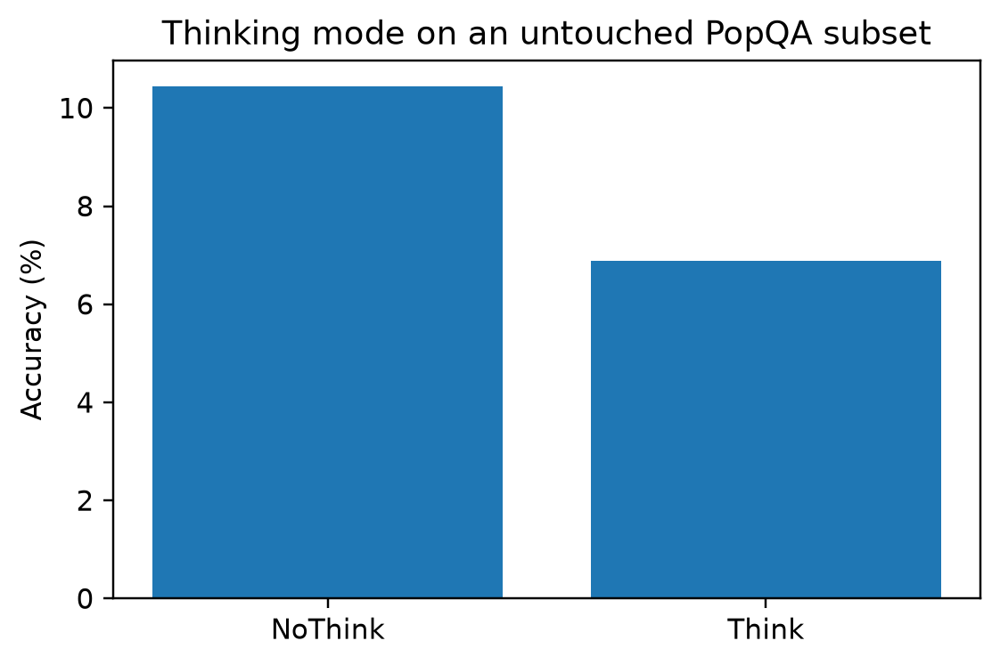

<p align="center">
  
</p>

<p align="center">
  <a href="https://www.wiml.org/events/wiml-workshop-neurips-2026"></a>
  
  
  
</p>

<p align="center">
  <a href="https://openreview.net/forum?id=IBSVk8DrQ0"><b>OpenReview</b></a> ·
  <a href="paper/WiML_More_Thinking_Less_Reading_Clean_Source.pdf"><b>Abstract PDF</b></a> ·
  <a href="#what-the-experiment-asks">Study</a> ·
  <a href="#results-at-a-glance">Results</a> ·
  <a href="#reproduce-the-analysis">Reproduce</a> ·
  <a href="#repository-guide">Files</a> ·
  <a href="docs/RESULTS.md">Detailed results</a>
</p>

# More Thinking, Less Reading?

### Separating Reasoning Utility from Evidence Selection in Factual QA

**Accepted abstract · [WiML Workshop @ NeurIPS 2026](https://www.wiml.org/events/wiml-workshop-neurips-2026)**<br>
**[Azka Ikramullah](https://openreview.net/profile?id=~Azka_Ikramullah1) · [Seong Oun Hwang](https://openreview.net/profile?id=~Seong_Oun_Hwang1)**<br>
[OpenReview submission #135](https://openreview.net/forum?id=IBSVk8DrQ0) · [Workshop PDF](https://openreview.net/pdf?id=IBSVk8DrQ0)

This repository contains the accompanying experiment, original notebook, archived predictions, figures, and abstract.

Does enabling a model's thinking mode help it answer simple factual questions? And when a supplied record conflicts with its knowledge, does thinking change which evidence it follows?

We compare **the same Qwen3-4B model with thinking OFF and ON**. On 150 untouched PopQA facts, thinking produces **39.4× more generated tokens** with **no observed factual-recall gain**. In a separate evidence-control experiment, both modes follow aligned and counterfactual records in **100% of tested cases**.

> Extra reasoning cost and evidence selection can be separated in this setting: generation grows substantially, while explicit records continue to control the answer. The accuracy difference is not statistically conclusive.

## What the experiment asks

The study uses two evaluation tracks so that selecting facts the model already knows does not determine the headline recall result.

| Track | Facts | Evaluation | Purpose |
|---|---|---|---|
| **Factual utility** | 150 untouched facts, excluded from all screening | No supplied context; Think vs. NoThink; three matched decoding seeds | Measure factual accuracy and generation cost without screening on either mode's success |
| **Evidence boundary** | 150 separately screened-known facts | No context, aligned records, and conflicting records; both modes; three matched decoding seeds | Test whether the answer follows explicit evidence or returns to a known prior |

The headline track contains **900 predictions**. The screened-known track contains **2,700 predictions**, including its no-context control; aligned and conflicting records account for 1,800 of those predictions. Screening outputs are archived separately.



Both modes use the same checkpoint, prompts within a condition, and sampling settings. The notebook switches modes using Qwen's `enable_thinking` chat-template option. Inference uses **4-bit NF4 quantization**. Generation caps are **64 tokens for NoThink** and **256 for Think**. In the archived independent run, **368/450 Think outputs (81.78%) reach the 256-token cap**, an important limit on interpreting the accuracy and token-cost comparison.

## Results at a glance

| Mode | Untouched factual accuracy | Generated tokens / answer | Aligned adherence | Conflict adherence | Conflict prior reversion |
|---|---:|---:|---:|---:|---:|
| **NoThink** | **10.44%** | **6.21** | 100% | 100% | 0% |
| **Think** | 6.89% | 244.53 | 100% | 100% | 0% |

**Think − NoThink accuracy:** −3.56 percentage points; fact-level 95% bootstrap CI **[−7.78, 0.00]**; paired Wilcoxon **p = 0.078**. The three decoding seeds are repeated measurements of each fact, not independent training runs. Headline uncertainty is computed over facts.

**Evidence selection:** zero context → prior flips among 450 matched conflict pairs. When aligned evidence and prior knowledge agree, source attribution cannot distinguish them; the conflicting-record condition provides the relevant source test.

<p align="center">
  
</p>

See [the full result notes](docs/RESULTS.md), the [combined table](results/abstract_combined_table.csv), and [per-prediction data](results/independent_factual_predictions.csv).

## Reproduce the analysis

### 1. Inspect the archived experiment

- Read the [accepted abstract PDF](paper/WiML_More_Thinking_Less_Reading_Clean_Source.pdf).
- Open the [original experiment notebook](notebooks/more_thinking_less_reading_experiment.ipynb).
- Browse [the original results](results/) and the [experiment writing notes](results/ABSTRACT_WRITING_KIT.md).

The PDF provides the final abstract title. The preserved notebook and writing kit retain an earlier subtitle. The original result directory name, `grounding_drift_results`, also reflects the initial research question; the observed conflict results show **zero grounding drift**.

### 2. Recompute tables and figures without a GPU

From a local clone of this repository, create a Python virtual environment and activate it using your shell's usual command. Then run:

```bash
python -m pip install -r requirements.txt
python scripts/analyze_results.py --results-dir results --output-dir reproduction/analysis
```

This reads the archived prediction files and writes regenerated analysis into `reproduction/analysis`. It does not run model inference or download model weights. The original files in `results/` remain available for comparison.

The recovered [independent fact manifest](data/independent_facts.jsonl) includes gold aliases for all 150 headline facts. Reapplying the notebook's matching procedure reproduces **all 900 saved correctness labels with zero mismatches**; 16 correct predictions depend on alternate aliases. The [cache provenance record](data/cache_provenance.json) documents this derived supplement and its historical-revision caveat.

### 3. Run fresh model inference on a CUDA GPU

```bash
python -m pip install -r requirements-reproduce.txt
python scripts/run_experiment.py --smoke --candidate-pool 200 --target-examples 5 --independent-examples 10 --output-dir reproduction/smoke
```

After checking the smoke run, launch the complete evaluation:

```bash
python scripts/run_experiment.py --output-dir reproduction/full
```

Fresh inference downloads Qwen3-4B and PopQA and requires a suitable NVIDIA GPU, a CUDA-compatible PyTorch installation, and free disk space for model caches and outputs. The original run targeted a single A10 GPU with 4-bit loading. Historical package pins are preserved from the notebook; exact numerical agreement can depend on the software and GPU environment.

See [reproduction instructions](docs/REPRODUCING.md) for settings, checkpoints, and the distinction between archived artifacts and the extracted command-line implementation.

## Repository guide

| Path | What it contains |
|---|---|
| [`paper/`](paper/) | The supplied one-page WiML abstract PDF |
| [`notebooks/`](notebooks/) | Original experiment notebook, including its recorded outputs |
| [`results/`](results/) | Original CSV/JSONL predictions, screening records, tables, audit export, and PNG figures |
| [`data/`](data/) | Recovered independent fact aliases and the cache provenance record for this derived supplement |
| [`src/wiml/`](src/wiml/) | Python implementation extracted for running and analyzing the experiment |
| [`scripts/`](scripts/) | Entry points for archived-result analysis and fresh inference |
| [`docs/RESULTS.md`](docs/RESULTS.md) | Metrics, denominators, interpretation, and archive map |
| [`docs/REPRODUCING.md`](docs/REPRODUCING.md) | Reproduction setup and protocol details |
| [`docs/DATA_AND_PROVENANCE.md`](docs/DATA_AND_PROVENANCE.md) | Source provenance, archived environment, and available-artifact boundaries |
| [`SOURCE_MANIFEST.json`](SOURCE_MANIFEST.json) | Original source paths, file sizes, and SHA-256 hashes |
| [`docs/VALIDATION.md`](docs/VALIDATION.md) | Completed integrity checks, prediction audits, and validation environment |

The model checkpoint and the complete upstream dataset are obtained from their original providers, rather than bundled as model binaries. The repository includes the experiment's selected records and generated outputs needed to inspect the reported study.

## How to interpret this work

- **Supported:** thinking generated substantially more tokens without an observed recall advantage under this protocol.
- **Supported:** explicit aligned and conflicting records were followed in every tested case in the evidence-control set.
- **Unresolved:** whether the small, negative accuracy difference reflects a reliable effect; its confidence interval reaches zero.
- **Scope:** one model size, one factual-QA dataset, NF4 inference, explicit evidence prompts, and bounded generation budgets.

The screened-known set is deliberately selected using NoThink performance. Its no-context recall numbers are diagnostics, not the unbiased headline comparison. Lexical alias matching can miss valid paraphrases, and `manual_audit.csv` is an export for inspection, not proof that a human audit was completed. Zero observed prior reversion under these prompts does not establish universal evidence adherence.

## References and citation

- [Qwen3-4B model card](https://huggingface.co/Qwen/Qwen3-4B) and [Qwen3 Technical Report](https://arxiv.org/abs/2505.09388).
- [PopQA dataset](https://huggingface.co/datasets/akariasai/PopQA) and [When Not to Trust Language Models](https://aclanthology.org/2023.acl-long.546/).
- [Scaling LLM Test-Time Compute Optimally](https://arxiv.org/abs/2408.03314).
- [DisentQA](https://aclanthology.org/2023.acl-long.559/).

Use [`CITATION.cff`](CITATION.cff) or the abstract citation below. Upstream model and dataset terms apply to their respective materials.

```bibtex
@inproceedings{ikramullah2026morethinking,
  title     = {More Thinking, Less Reading? Separating Reasoning Utility from Evidence Selection in Factual QA},
  author    = {Ikramullah, Azka and Hwang, Seong Oun},
  booktitle = {WiML Workshop at NeurIPS 2026},
  year      = {2026},
  url       = {https://openreview.net/forum?id=IBSVk8DrQ0},
  note      = {Accepted workshop abstract}
}
```

## License and third-party materials

No open-source license has been selected for this private review copy. Model, dataset, and third-party package terms apply to their respective materials; see [data and source provenance](docs/DATA_AND_PROVENANCE.md).
