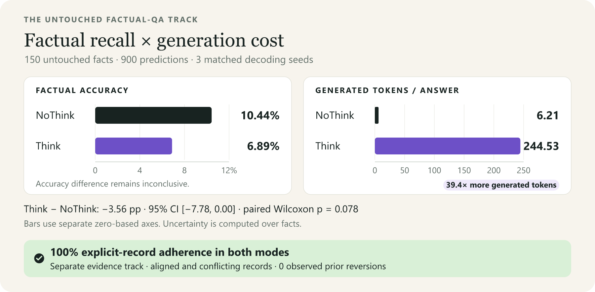
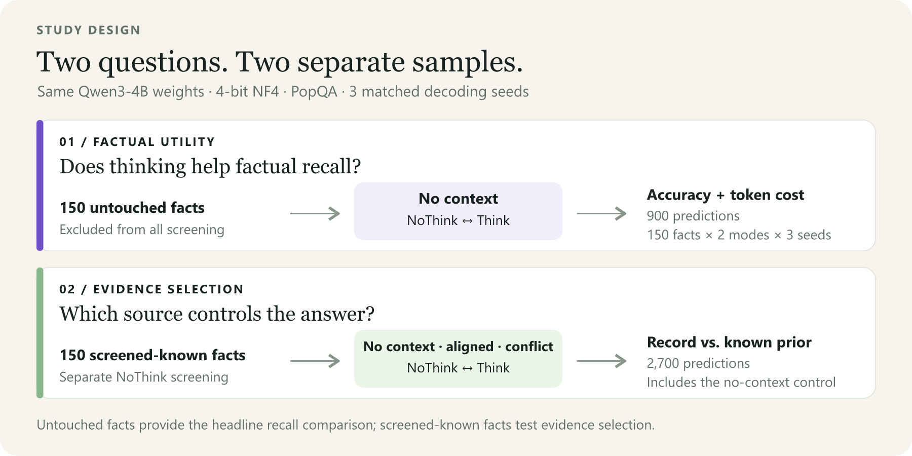

<p align="center">
  
</p>

<p align="center">
  <a href="https://openreview.net/profile?id=~Azka_Ikramullah1"><b>Azka Ikramullah</b></a> &nbsp;·&nbsp;
  <a href="https://openreview.net/profile?id=~Seong_Oun_Hwang1"><b>Seong Oun Hwang</b></a>
</p>
<p align="center">
  <b>Accepted abstract · <a href="https://www.wiml.org/events/wiml-workshop-neurips-2026">WiML Workshop @ NeurIPS 2026</a></b> &nbsp;·&nbsp; Submission #135
</p>
<p align="center">
  <a href="paper/WiML_More_Thinking_Less_Reading_Clean_Source.pdf"></a>
  <a href="https://openreview.net/forum?id=IBSVk8DrQ0"></a>
  <a href="#reproduce-the-results"></a>
</p>

## Does more thinking help factual recall?

Reasoning modes generate longer answers, but what does that extra computation buy for simple factual questions? We compare **the same Qwen3-4B weights with thinking OFF and ON**, measuring both factual recall and which evidence controls the answer.

## The finding

<p align="center">
  
</p>

**More generated tokens, no observed recall gain, and no observed shift away from explicit evidence.** The accuracy difference is not statistically conclusive.

**Important scope:** NoThink and Think had generation caps of 64 and 256 tokens. **81.78% of Think outputs reached the cap.** These results describe one Qwen3-4B/PopQA setting under those budgets; token counts measure generation volume, not latency or monetary cost. [Read the result notes →](docs/RESULTS.md)

## One model. Two separate tests.

<p align="center">
  
</p>

The untouched facts are excluded from **all screening**. Keeping the tracks separate prevents NoThink-based selection from determining the headline accuracy comparison. Uncertainty for that comparison is computed over facts, with the three seeds treated as repeated measurements.

## Reproduce the results

From a clone of this repository, activate a Python environment and run:

```bash
python -m pip install -r requirements.txt
python scripts/analyze_results.py --results-dir results --output-dir reproduction/analysis
```

This regenerates tables, statistical tests, and figures from the saved predictions on a **CPU**. No model download or API key is needed. Prefer a notebook? [Open the original experiment →](notebooks/more_thinking_less_reading_experiment.ipynb)

## Explore the work

| Start here | What you will find |
|---|---|
| [Abstract PDF](paper/WiML_More_Thinking_Less_Reading_Clean_Source.pdf) · [OpenReview](https://openreview.net/forum?id=IBSVk8DrQ0) | The accepted WiML abstract and submission |
| [Experiment code](src/wiml/) · [Original notebook](notebooks/more_thinking_less_reading_experiment.ipynb) | Prompts, sampling, scoring, inference, and analysis |
| [Predictions & figures](results/) · [Fact aliases](data/independent_facts.jsonl) | Original outputs and recovered metadata for checking labels |
| [Reproduction guide](docs/REPRODUCING.md) · [Detailed results](docs/RESULTS.md) | Full protocol, statistical interpretation, and run settings |
| [Validation](docs/VALIDATION.md) · [Source provenance](docs/DATA_AND_PROVENANCE.md) | Completed checks, original checksums, and archive boundaries |

<details>
<summary><b>Protocol, limitations, and what the archive preserves</b></summary>

- **Model:** Qwen3-4B with 4-bit NF4 loading. Both modes share checkpoint, prompts within each condition, and evaluation sampling settings: temperature 0.6, top-p 0.95, top-k 20.
- **Factual utility:** 150 untouched facts × two modes × three matched decoding seeds = **900 predictions**. Think − NoThink accuracy is **−3.56 percentage points**, with fact-level bootstrap 95% CI **[−7.78, 0.00]** and paired Wilcoxon **p = 0.078**.
- **Evidence selection:** a separate 150 screened-known facts × three conditions × two modes × three seeds = **2,700 predictions**. The conditions are no context, aligned records, and conflicting fictional records. The no-context diagnostic on this selected set is not the headline recall comparison.
- **Observed boundary:** 100% aligned/conflict adherence in the tested set and zero context → prior flips among 450 matched conflict pairs. Aligned records alone cannot distinguish context use from prior recall because the answers agree.
- **Limits:** one model size, one dataset, low absolute recall, lexical alias scoring, explicit evidence instructions, and different generation budgets. Reaching a token cap does not alone establish truncation; the independent CSV has no finish reasons or full thinking trace. The audit export is not proof of completed human review.
- **Preservation:** the original notebook, fifteen result/figure/documentation files, and supplied PDF are kept byte for byte. The notebook retains an earlier subtitle. The architecture figure, writing kit, and PDF have no recovered editable generator/source in the original folder.
- **Recovered evidence:** aliases for all 150 independent facts reproduce all 900 saved correctness labels with zero mismatches. Sixteen correct outputs require an alternate alias. Observed cache revisions support reproduction but do not prove an exact historical runtime lock.

[Full protocol](docs/REPRODUCING.md) · [Results and denominators](docs/RESULTS.md) · [Provenance](docs/DATA_AND_PROVENANCE.md)

</details>

<details>
<summary><b>Fresh GPU inference and integrity checks</b></summary>

Install the additional inference dependencies, then start with an explicitly smaller diagnostic run:

```bash
python -m pip install -r requirements-reproduce.txt
python scripts/run_experiment.py --smoke --candidate-pool 200 --target-examples 5 --independent-examples 10 --output-dir reproduction/smoke
```

The smoke run uses changed sample sizes and is not guaranteed to find five recalled facts. For the full protocol:

```bash
python scripts/run_experiment.py --output-dir reproduction/full
```

Fresh inference requires a suitable NVIDIA GPU, CUDA-compatible PyTorch, and space for Qwen3-4B and PopQA downloads. The historical run targeted a single A10 GPU. Three dependency pins are preserved from the original notebook; the complete historical environment was not locked. See the [reproduction guide](docs/REPRODUCING.md) for checkpoint handling and optional revision pins.

To check archived bytes and run the offline tests:

```bash
python tools/verify_archive.py
python -m pip install pytest
python -m pytest -q
```

All **10 offline tests** and GitHub validation passed during repository preparation. Full GPU inference was not rerun. Model weights and the complete upstream dataset are downloaded separately.

</details>

<details>
<summary><b>Citation and references</b></summary>

Please cite the accepted workshop abstract using [`CITATION.cff`](CITATION.cff) or:

```bibtex
@inproceedings{ikramullah2026morethinking,
  title     = {More Thinking, Less Reading? Separating Reasoning Utility from Evidence Selection in Factual QA},
  author    = {Ikramullah, Azka and Hwang, Seong Oun},
  booktitle = {WiML Workshop at NeurIPS 2026},
  year      = {2026},
  url       = {https://openreview.net/forum?id=IBSVk8DrQ0},
  note      = {Accepted workshop abstract}
}
```

- [Qwen3-4B model card](https://huggingface.co/Qwen/Qwen3-4B) · [Qwen3 Technical Report](https://arxiv.org/abs/2505.09388).
- [PopQA dataset](https://huggingface.co/datasets/akariasai/PopQA) · [When Not to Trust Language Models](https://aclanthology.org/2023.acl-long.546/).
- [Scaling LLM Test-Time Compute Optimally](https://arxiv.org/abs/2408.03314).
- [DisentQA](https://aclanthology.org/2023.acl-long.559/).

No open-source license has been selected. Upstream model, dataset, and package terms continue to apply.

</details>

---

<p align="center">
  <b>Inspect the evidence. Reproduce the analysis.</b><br>
  <a href="SOURCE_MANIFEST.json">Source manifest</a> &nbsp;·&nbsp;
  <a href="docs/VALIDATION.md">Validation report</a> &nbsp;·&nbsp;
  <a href="https://openreview.net/forum?id=IBSVk8DrQ0">WiML @ NeurIPS 2026</a>
</p>
